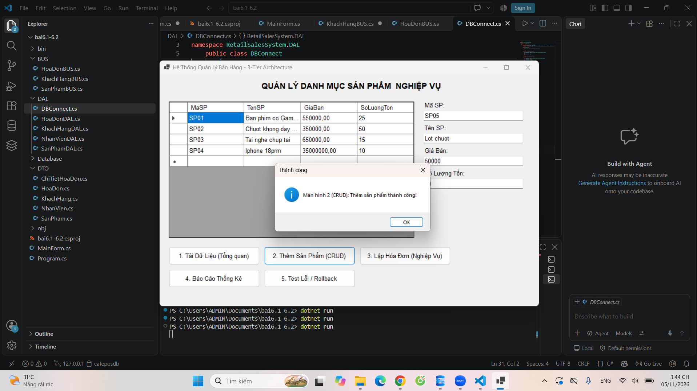
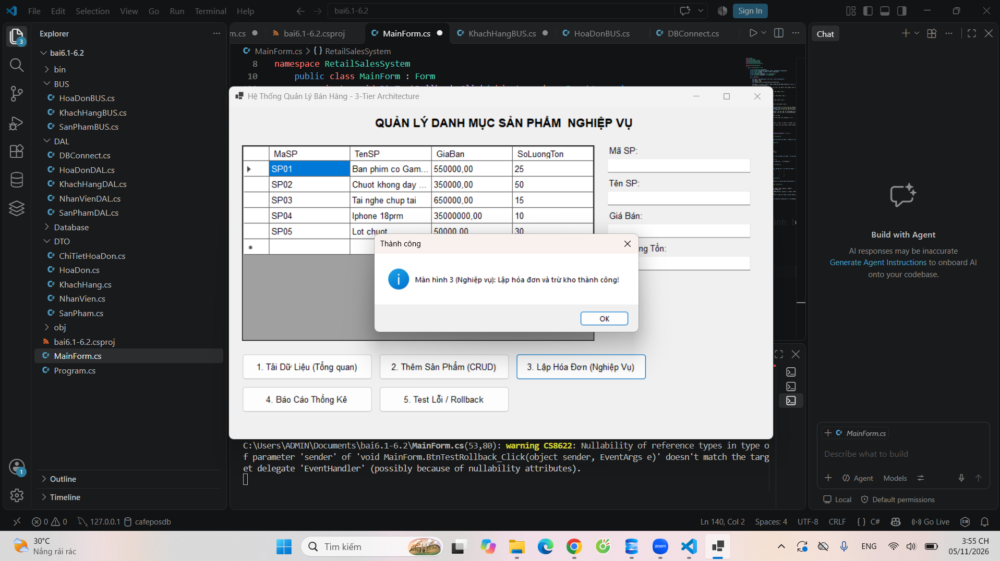
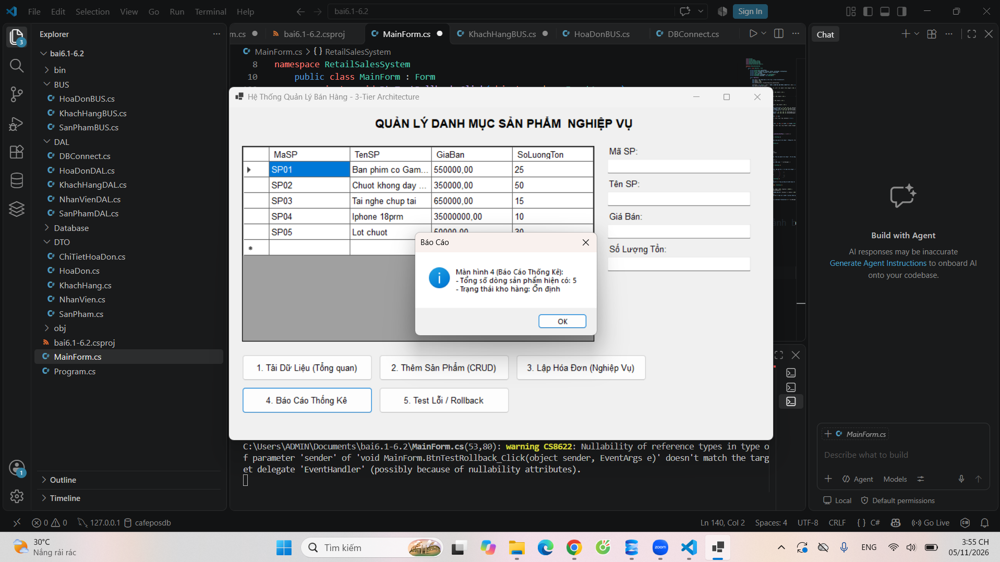
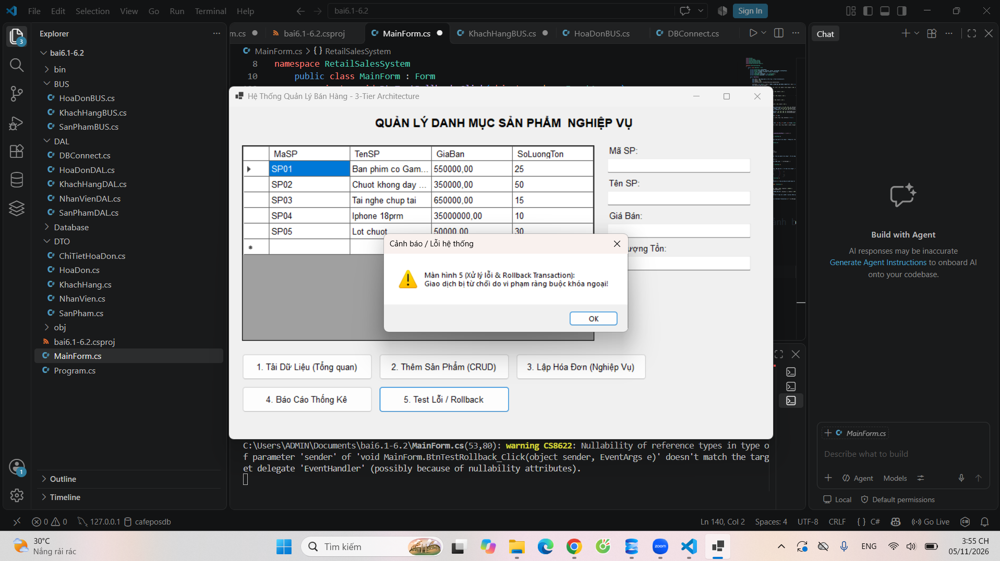

# MỤC 1: THÔNG TIN SINH VIÊN
- Họ và tên sinh viên: Bùi Lê Hoàn
- Mã sinh viên: [Điền Mã Sinh Viên của bạn vào đây]
- Tên Đề tài / Bài tập: Hệ Thống Quản Lý Bán Hàng (3-Tier Architecture)

---

# MỤC 2: HƯỚNG DẪN CÀI ĐẶT & CHẠY DỰ ÁN

## Các bước cài đặt:
1. Mở SQL Server Management Studio (SSMS), chạy file `Database/ScriptDB.sql` để khởi tạo CSDL và dữ liệu mẫu.
2. Mở file `.sln` bằng Visual Studio 2022 (hoặc mở thư mục project bằng Visual Studio Code).
3. Mở file cấu hình (`App.config` hoặc `DBConnect.cs`), sửa lại chuỗi kết nối `ConnectionString` cho phù hợp với máy cá nhân.
4. Build & Run dự án (F5 hoặc lệnh `dotnet run`).

---

# MỤC 3: HÌNH ẢNH KẾT QUẢ CÁC MÀN HÌNH CHỨC NĂNG

1. **Màn hình Chính / Tổng quan:**
   

2. **Màn hình Quản lý Danh mục / Thêm Sửa Xóa (CRUD):**
   

3. **Màn hình Thực thi Nghiệp vụ chính (Lập hóa đơn / Trừ kho):**
   

4. **Màn hình Báo cáo Thống kê:**
   

5. **Minh họa Xử lý lỗi hoặc Rollback Transaction:**
   